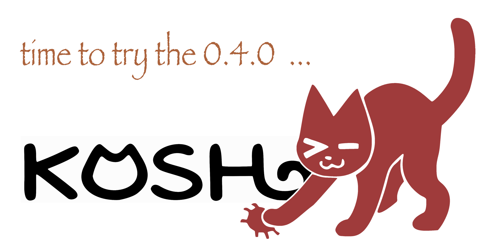

[](https://github.com/fennec-support/kosh/actions/workflows/ci.yml)

# koshka-oriented shell



## Contents

- [Install](#install)
- [Quick look](#quick-look)
  - [How to use it](#how-to-use-it)
  - [Shell linter, formatter, and language server](#shell-linter-formatter-and-language-server)
  - [Interactive shell and command interpreter](#interactive-shell-and-command-interpreter)
  - [Builtins and interactive editor](#builtins-and-interactive-editor)
  - [Koshkit](#koshkit)
- [Development](#development)
  - [Prerequisites](#prerequisites)
  - [Build](#build)

## Install

Built for `amd64` (Linux, Windows) and `aarch64` (macOS, Linux).

```sh
# on Linux, macOS, or any system with a POSIX shell:
curl -fsSL "https://fennec.support/kosh/install" | sh

# same platforms, via Homebrew:
brew tap fennec-support/kosh
brew install fennec-support/kosh/kosh

# on Windows, Powershell:
irm "https://fennec.support/kosh/install" | iex

# with Docker, as an Alpine image:
docker run --rm -it "ghcr.io/toiletbril/kosh"
```

Prebuilt binaries and checksums can be found in the
[Releases](https://github.com/fennec-support/kosh/releases) page. For source
builds, jump to [Development](#development).

Existing Bash startup configs will keep working untouched.
See [Switching from Bash](docs/kosh_switching_5.md).

Editor plugins for real-time linting and formatting:

- [VS Code](https://github.com/fennec-support/kosh-vscode)
- [Zed](https://github.com/fennec-support/kosh-zed)
- [Neovim](https://github.com/fennec-support/kosh.nvim)

## Quick look

| Your shell is now an IDE |
| :-: |
|  |

**Koshka** is the Russian word for a cat.

Packed into a single tiny cross-platform binary are a script interpreter, an
interactive shell, a linter, a formatter, and an LSP server. Scripts written
for Bash 5.3 or Dash will run completely unchanged.

Expect roughly 5x the execution speed of Bash and over 100x the linting speed
of ShellCheck, with 300+ ShellCheck-style diagnostics baked straight into the
binary.

| 400,000 lines of shell checked in about a second and a half |
| :-: |
|  |

Shell code rarely stays confined to `.sh` files. Koshka extracts and checks
embedded Bash and POSIX snippets straight out of the following formats.

- CI/CD. GitHub Actions, GitLab CI, Gitea/Forgejo Actions, CircleCI, Azure
  Pipelines, Bitbucket Pipelines, Buildkite, Travis CI, Google Cloud Build,
  Drone, and Woodpecker.
- Infra & Containers. Ansible playbooks, Dockerfiles, Containerfiles,
  Compose files, and Kubernetes manifests.
- Build systems. Makefiles, Justfiles, Taskfiles, and RPM `.spec` files.
- Docs & Tooling. Markdown code blocks, `package.json` scripts, VS Code
  tasks, and Dev Container configs.

| Diagnostics appear while typing in scripts, Dockerfiles, CI files, and Ansible playbooks |
| :-: |
|  |

Hook up the language server for live completions, auto-formatting, document
outlines, and full diagnostic explanations on hover.

| Completion and diagnostics appear while writing code |
| :-: |
|  |

### How to use it

`kosh` is the **Koshka** binary.

Designed from the ground up to replace both ShellCheck and Bash, Koshka
treats Linux, macOS, and Windows as first-tier platforms with identical
behavior across all three.

Configuration is in `/etc/kosh.conf` and `~/.config/kosh/kosh.conf`, managed
at runtime through the `koshconf` builtin. Running `koshconf create kosh` will
generate a fresh config file documenting every available setting.

### Shell linter, formatter, and language server

Validate and format scripts safely before execution. None of these flags will
ever execute the target code.

| Flag | What happens |
| :-- | :-- |
| `kosh --lint` | Validates full Bash and POSIX syntax against ~300 built-in ShellCheck and native rules. Accepts shell source via `stdin`, `-c` command strings, or multiple file paths.<br><br>When pointed at host files (YAML, Dockerfiles, Markdown), the linter isolates and checks only the embedded `sh`, `bash`, or `kosh` regions while rejecting unsupported formats.<br><br>Honors `# shellcheck disable` comments using either SC numbers or Koshka diagnostic slugs. Passing `--apply` will automatically write safe, non-conflicting fixes to disk and report any remaining issues. |
| `kosh --format` | Formats `stdin` or a single file using two-space indentation and safe token wrapping at 80 columns. Pass `--apply` to overwrite files in place.<br><br>Formatting style is intentionally locked; no config files or style bikeshedding. |
| `kosh --as-language-server` | Speaks LSP over `stdio`, delivering diagnostics, quick fixes, autocomplete, jump-to-definition, command help, semantic tokens, document outlines, and symbol renaming.<br><br>Detects the exact same embedded shell regions as the linter, leaving the surrounding syntax to the host editor's language services.<br><br>See [Install](#install) for editor plugins. |

### Interactive shell and command interpreter

Full documentation lives in the [manual](docs/kosh_1.md), or locally via `man`.

```bash
$ man man/kosh.1
```

Koshka operates across four "moods" and three shell identities (similar to
Zsh's `emulate` builtin).

- `kosh` (default). A strict superset of Bash with whole-script static analysis
  and optimization enabled. Risky constructs that Bash runs without complaint,
  such as an unquoted `echo $HOME`, will be rejected before anything even runs.
- `bash`. Drop-in Bash 5.3 compatibility. Run legacy scripts untouched via
  `kosh --mood bash script.bash`.
- `bash-posix`. Bash behavior with POSIX mode.
- `sh`. Strict POSIX / Dash compatibility.

Before executing any command, Koshka parses, analyzes, and optimizes the
entire script from top to bottom.

| Flag / Var | Behavior |
| :-- | :-- |
| `--mood`, `-M` | Selects `kosh`, `bash`, `bash-posix`, or `sh` (`kosh` by default). Symlinking the binary as `sh`, `dash`, or `bash` will automatically lock in the matching mood and silence diagnostics. Run `koshconf set mood bash` to switch mid-session, adding `--persist` to save the change to `kosh.conf`. |
| `-W`, `-WW`, `-WWW` | Adjusts diagnostic strictness. In the default `kosh` mood, `-W` keeps default severities, `-WW` demotes lenient errors to warnings, and `-WWW` demotes strict errors as well. In compatibility moods, `-W`, `-WW`, and `-WWW` progressively enable strict, lenient, and annoying warnings. |
| `-I` | Enables shebang mimicry. Koshka inspects `sh`, `dash`, and `bash` shebangs to run each script in its matching mood while preserving active diagnostic flags. |
| `--init-moods`, `-L` | Takes a comma-separated list of moods whose startup files should be sourced (defaults to the active mood; configurable via `init_moods` in `kosh.conf`). |
| `KOSH_FLAGS` | Environment variable for setting default flags (overridden by CLI arguments).<br><br>*Fail-safe.* If `KOSH_FLAGS` or the command line contains a broken flag on a login shell, startup files are bypassed and a rescue session opens immediately to prevent lockouts. |

Most native settings are stored in `/etc/kosh.conf` and
`~/.config/kosh/kosh.conf`, viewed and changed by the `koshconf` builtin.

### Builtins and interactive editor

Ditching `readline` entirely (and ignoring `inputrc` configs), the interactive
line editor takes inspiration from
[fish](https://github.com/fish-shell/fish-shell). Typing a command brings up
live syntax highlighting and inline descriptions, backed by word movement, full
UTF-8 and wide-character display handling, multiline editing, and persistent
history search.

Over 50 builtins come compiled in, covering standard Bash and POSIX commands
(`--help` works on every single one) alongside custom tools rarely seen in
other shells.

- `z` is a native port of [zoxide](https://github.com/ajeetdsouza/zoxide)
  for instant directory jumping.
- `bench` built-in benchmarking suite inspired by the Performance
  Optimizer Observation Platform ([poop](https://github.com/andrewrk/poop)).
- `assimilate` transactionally deploys Koshka onto a remote target over
  SSH.
- `calc` is an arbitrary-precision arithmetic (including floats), which also
  powers math in the default `kosh` mood.

### Koshkit

Stuck on a stripped-down container or rescue image missing standard system
tools? The `koshkit` builtin bundles a BusyBox-style collection of
POSIX-compliant core utilities into the binary.

- Files. `cp`, `mv`, `ln`, `rm`
- Search. `find`, `grep`
- Processes. `killall`, `pkill`, `ps`, `timeout`, `nproc`
- Extras. Minimal implementations of `calc` and `make`

It also comes with special `good`... and `evil`... utilities, to view system
logs, collect coredump with all of it's dependencies, watch directories for
changes, inspect inodes and so on. A full list can be listed via `koshkit
--help`.

# Development

This software began as a late April Fools' joke. It is written from scratch in a
macro-heavy C++23 dialect and is compiled with `-nostdlib++`. The executable
links only to the C library.

Development happens on `staging`. The branch may be broken. The `master` branch
should pass all tests.

## Prerequisites

A native build needs the following tools.

* Install GNU Make, Clang 18 or later with C++23 support, libc development
  files, and headers for the target platform. Linux builds also need Linux
  kernel headers.
* The default debug build needs the AddressSanitizer and
  UndefinedBehaviorSanitizer runtimes from `compiler-rt`.
* The test suite needs Bash 5.3, Dash, and Python 3.
* The build and test scripts need `mkdir`, `rm`, `cp`, and `printf` from the
  host.
* The full test suite needs `cat`, `cmp`, `diff`, `find`, `grep`, `head`, `sed`,
  and `strings`. Interactive tests also need `script` and `stty`. Process
  supervision needs `setsid` or Perl.

A complete Alpine setup can be installed with the following package set.

```bash
apk add --no-cache \
  git git-doc make build-base musl-dev linux-headers clang llvm lld \
  compiler-rt bash dash zsh yash busybox coreutils mandoc python3
```

The benchmark needs Bash, Dash, and Python 3. Zsh, Yash, and BusyBox ash provide
optional comparison rows. The coverage report needs `llvm-profdata` and
`llvm-cov` from the matching LLVM installation. Documentation checks use
`mandoc`. Formatting and static checks use `clang-format` and `clang-tidy` from
Clang 18 or later.

Each cross-compilation target needs its matching toolchain. Zig builds the Zig
targets and cross-compiles Linux release binaries. MinGW-w64 builds Windows
targets. Osxcross with a macOS SDK builds Darwin arm64 targets. `cosmoc++` builds
the Cosmopolitan modes.

## Build

Clone the repository with its editor submodule.

```sh
git clone --recursive https://github.com/fennec-support/kosh.git
cd kosh
git switch staging
```

In an existing checkout, initialize the submodule before building.

```sh
git submodule update --init --recursive
```

The `MODE` variable controls the build type.

* `rel` is an optimized build.
* `tinyrel` is a size-optimized build. It is up to 40% smaller on disk
  than `rel` and uses about 15% less memory, at cost of some speed.
* `prof` is an optimized build with debug symbols for profiling.
* `cov` is an optimized build with debug symbols for collecting coverage.
* `dbg` includes all symbols, AddressSanitizer, and UndefinedBehaviorSanitizer.
* `cosmo` is an optimized build that uses `cosmoc++` from the Cosmopolitan
  toolchain.
* `cosmo_dbg` is a debug Cosmopolitan build.

`TARGET` defaults to the host platform and accepts `Linux`, `Windows_NT`, or
`Darwin`.
A non-Windows host cross-compiles `TARGET=Windows_NT` with MinGW. A non-Darwin
host cross-compiles `TARGET=Darwin ARCH=arm64` with osxcross. Linux is a native
target.

`NO_KOSHKIT=1` leaves out the bundled Koshkit utilities, which makes the binary
about 20% smaller. It combines with any mode, for example
`make MODE=tinyrel NO_KOSHKIT=1`.

The `CXXFLAGS` environment variable appends flags to the build commands.

```bash
$ make MODE=<rel/tinyrel/prof/dbg/cov/cosmo/cosmo_dbg>
$ make MODE=rel TARGET=Windows_NT
$ make MODE=rel TARGET=Darwin ARCH=arm64
$ ./kosh --help
```

Zig can also build the `dbg` and `rel` modes.

```bash
$ zig build --release=fast
$ ./zig-out/bin/kosh --help
```

Install or uninstall the selected build with the following commands.

```bash
$ export PREFIX=/usr/local
$ make install
$ make uninstall
```

Assuming the same arch and target, the running binary can install itself on an
SSH target with a builtin command: `assimilate user@host`.

Meow.

---


